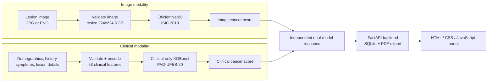
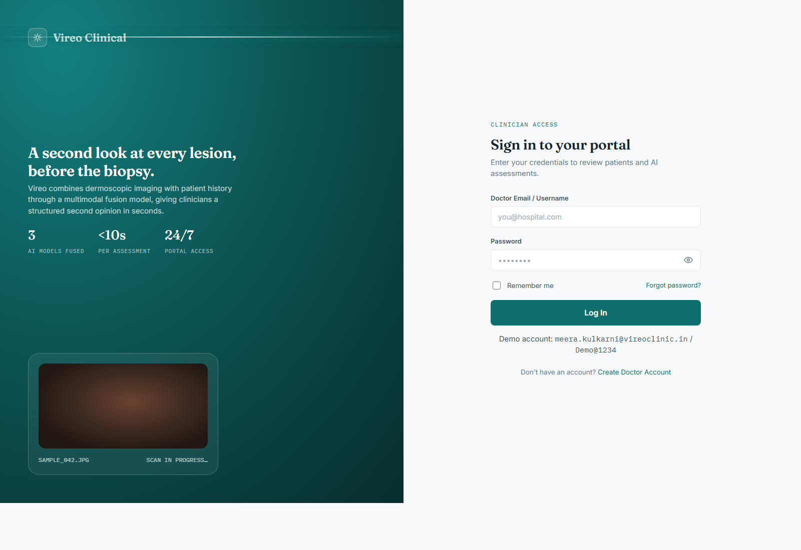
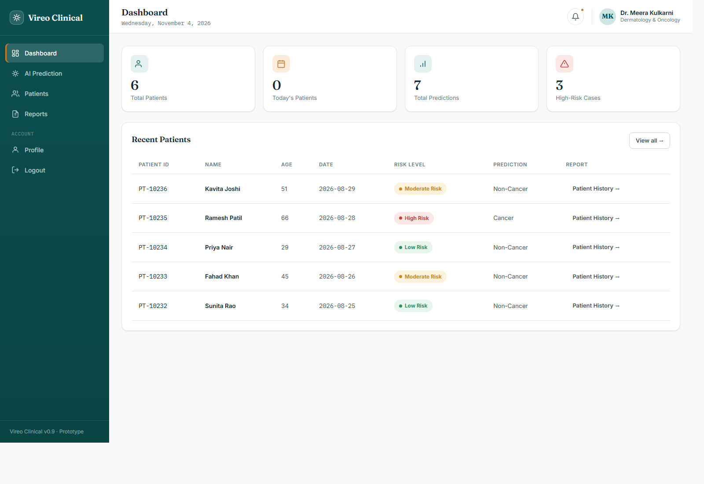
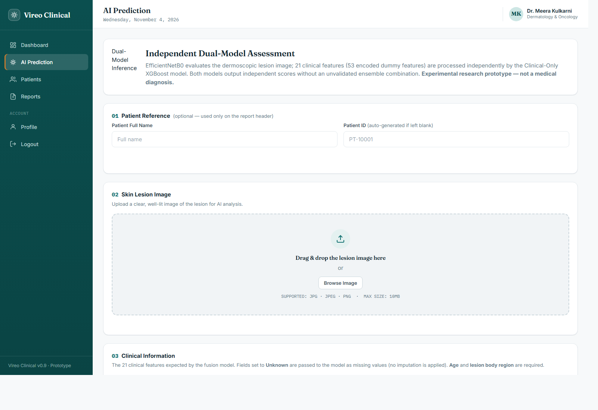
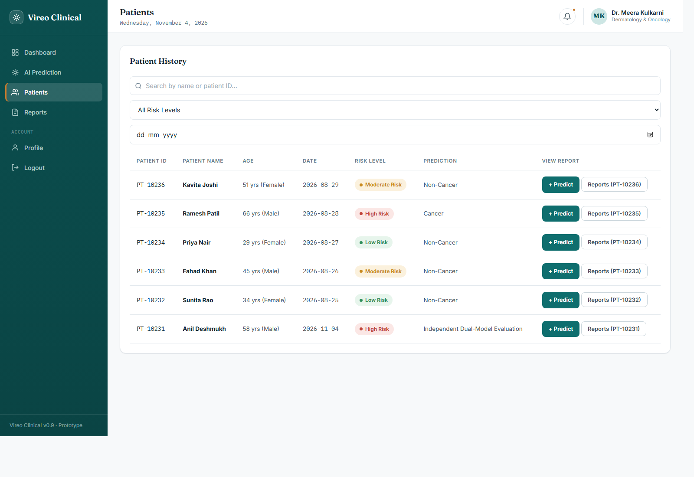
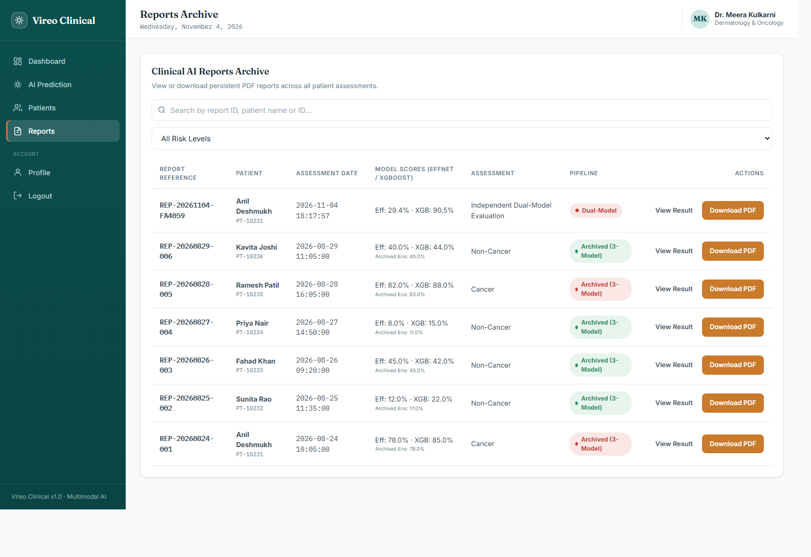
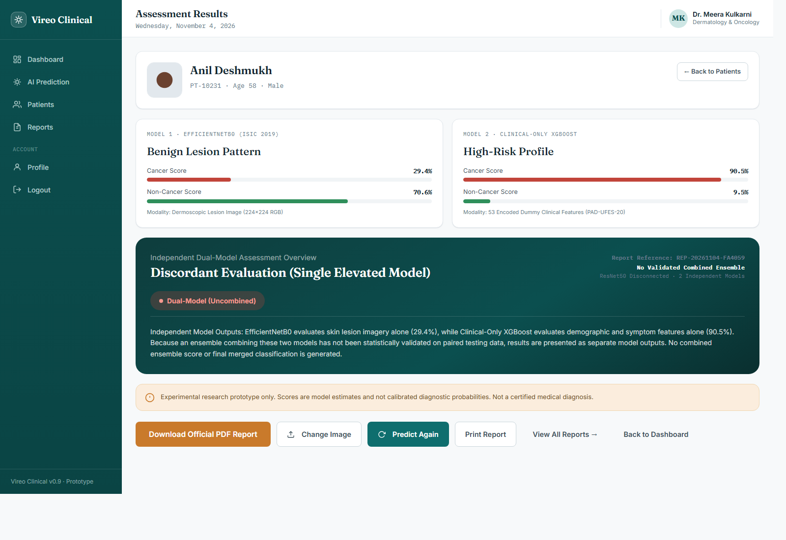

# Multimodal Skin Cancer Detection System

**A research prototype for independent image-based and clinical risk assessment of skin lesions.**

[](https://www.python.org/)
[](https://www.tensorflow.org/)
[](https://fastapi.tiangolo.com/)
[](https://xgboost.readthedocs.io/)
[](LICENSE)

> **Project status:** academic and research prototype only. This repository documents the code that actually runs. It does **not** claim a clinically validated multimodal fusion model, and it is **not** a medical device.

---

## Table of Contents

1. [Overview](#1-overview)
2. [Problem Statement](#2-problem-statement)
3. [Project Objectives](#3-project-objectives)
4. [Technology Stack](#4-technology-stack)
5. [System Architecture](#5-system-architecture)
6. [EfficientNetB0 Image Model](#6-efficientnetb0-image-model)
7. [XGBoost Methodology and Fusion Status](#7-xgboost-methodology-and-fusion-status)
8. [Dataset Information](#8-dataset-information)
9. [Data Preprocessing](#9-data-preprocessing)
10. [Model Evaluation Metrics](#10-model-evaluation-metrics)
11. [Installation](#11-installation)
12. [Backend Execution](#12-backend-execution)
13. [Frontend Execution](#13-frontend-execution)
14. [API Endpoint Documentation](#14-api-endpoint-documentation)
15. [Screenshots](#15-screenshots)
16. [Project Folder Structure](#16-project-folder-structure)
17. [Limitations](#17-limitations)
18. [Future Scope](#18-future-scope)
19. [Medical Disclaimer](#19-medical-disclaimer)
20. [Provenance and License](#20-provenance-and-license)

---

## 1. Overview

This project is a doctor-facing web prototype for computer-assisted skin-lesion assessment. It combines two complementary sources of information:

- a **dermoscopic lesion image**, analysed by **EfficientNetB0** trained on **ISIC 2019**;
- **patient and lesion information**, analysed by a **clinical-only XGBoost** model trained on **PAD-UFES-20** metadata.

The two models are loaded once by a **FastAPI** backend and are exposed to a static **HTML/CSS/JavaScript** doctor portal. Patient records, reports and downloadable PDF summaries are stored in a local SQLite database.

### Important implementation note

The requested project title is "Multimodal Skin Cancer Detection System", and the original project explored multimodal fusion. However, the current verified code **does not compute a combined fusion score**. The EfficientNetB0 image score and the clinical XGBoost score are returned as **independent assessments**. The original `prediction.py` explicitly states that an ensemble combining the two models has not been statistically validated on paired data.

This README therefore documents the **actual implemented pipeline**, not the earlier three-model fusion design. ResNet50 has been removed from the final architecture and is not loaded or executed.

### Verified working state

| Check | Result |
|---|---|
| FastAPI starts | Yes |
| EfficientNetB0 weights load | Yes |
| Clinical XGBoost JSON loads | Yes |
| 53-feature schema loads | Yes |
| `/health` returns healthy | Yes |
| Live prediction tested | Yes |
| ResNet50 loaded | No |
| Validated combined ensemble | No |

---

## 2. Problem Statement

Skin lesions can be benign, precancerous or malignant, and their visual appearance may overlap. A single image classifier can miss useful patient context, while a purely tabular model cannot learn visual patterns. The project investigates whether image-based deep learning and structured clinical information can be served together in one reproducible, well-validated engineering workflow.

The problem addressed here is **not** "build an autonomous diagnosis system". It is:

> Build a modular, reproducible prototype that assesses a lesion image and a clinical profile, exposes both model outputs safely through a web API, and documents their limitations honestly.

---

## 3. Project Objectives

The implemented objectives are:

1. Prepare and use ISIC 2019 images for EfficientNetB0 binary classification.
2. Train and evaluate a clinical-only XGBoost classifier on PAD-UFES-20 metadata.
3. Preserve the exact training-time feature order, categorical vocabularies and missing-value policy in inference.
4. Build a FastAPI backend that loads both models once at startup and validates uploads and clinical fields.
5. Build a doctor-facing HTML/CSS/JavaScript portal with patient records, reports and PDF export.
6. Persist assessment history in SQLite for demonstration purposes.
7. Keep the two model outputs separate unless and until a fusion model is validated on paired data.
8. Report only metrics that exist in the original evaluation artifacts.

---

## 4. Technology Stack

| Layer | Technology | Role |
|---|---|---|
| Image model | TensorFlow 2.19 / Keras 3.15 | EfficientNetB0 training and inference |
| Image backbone | EfficientNetB0 | Binary lesion-image classifier |
| Clinical model | XGBoost 3.4 (`XGBClassifier`) | Clinical-only tabular classifier |
| Data processing | NumPy, pandas, scikit-learn | Preprocessing, splitting, evaluation |
| Image I/O | Pillow | Upload validation and resizing |
| Backend | FastAPI 0.143 | REST API, validation, OpenAPI docs |
| ASGI server | Uvicorn 0.54 | Local API server |
| Database | SQLite (Python `sqlite3`) | Demo patient/report persistence |
| PDF reports | Custom pure-Python PDF 1.4 writer | Downloadable assessment summaries |
| Frontend | HTML5, CSS3, JavaScript (ES6) | Static doctor portal |
| Runtime | Python 3.12.10, Windows | Verified local environment |

No Node.js build step is required for the frontend that is included here.

---

## 5. System Architecture

The active architecture contains **two independent model branches** and no fusion layer.



### Runtime request flow

1. The clinician uploads a lesion image and fills in 21 clinical fields.
2. FastAPI validates the image bytes, size, format and clinical values.
3. EfficientNetB0 receives a 224×224 RGB image and returns a sigmoid image score.
4. The clinical preprocessor builds the exact 53-feature row expected by XGBoost.
5. Clinical-only XGBoost returns a clinical cancer score.
6. Both scores are returned separately, with a notice that no validated ensemble exists.
7. The portal can persist the assessment as a report and download a PDF.

### ResNet50 status

ResNet50 was part of an earlier three-model experiment. It is **not** part of the final architecture, is not loaded by `model_loader.py`, and is not executed during prediction. The historical report and architecture image still mention it; see `documentation/README.md` for that provenance note.

---

## 6. EfficientNetB0 Image Model

| Property | Value |
|---|---|
| Architecture | EfficientNetB0, ImageNet initialization, no original classification top |
| Dataset | ISIC 2019, 224×224 resized working set |
| Input | 224 × 224 × 3 RGB |
| Head | Global average pooling → dropout → one sigmoid unit |
| Output | Cancer score in `[0, 1]` |
| Training | Two phases: head training, then fine-tuning of the final 30 layers |
| Batch size | 16 |
| Head phase | 10 epochs, learning rate `1e-4` |
| Fine-tuning | 10 epochs, learning rate `1e-5` |
| Seed | 42 |
| Artifact | `training/models/efficientnet_b0_best.keras` |
| Artifact size | 28,956,745 bytes |
| SHA-256 | `6FD74D96F47446E10581C9E7BF775E4385362C4124C68B44B763BBDC73A9558D` |

Inference uses `tensorflow.keras.applications.efficientnet.preprocess_input` on raw `[0, 255]` float32 RGB pixels, matching the saved training pipeline. The weight file is **not committed** because of its size; see `training/models/README.md`.

---

## 7. XGBoost Methodology and Fusion Status

### 7.1 What the active model does

The active XGBoost artifact is a **clinical-only** classifier. It consumes **53 encoded clinical features** derived from 21 raw form fields, including:

- age, lesion diameters, Fitzpatrick skin type;
- smoking, alcohol, pesticide exposure;
- personal history of skin cancer and other cancer;
- household water/sewage indicators;
- itching, growth, pain, recent change, bleeding, elevation;
- family ancestry and lesion body region.

It does **not** receive the EfficientNet prediction, image embeddings or any pixel data. `prediction.py` builds a clinical-only DataFrame and explicitly excludes CNN outputs.

### 7.2 Training configuration

| Property | Value |
|---|---|
| Algorithm | `XGBClassifier` |
| Artifact | `training/xgboost_fusion/clinical_xgboost.json` |
| Features | 53 |
| Max depth | 3 |
| Learning rate | 0.05 |
| Estimators | 2,000 with early stopping (50 rounds) |
| Subsample / colsample | 0.8 / 0.8 |
| Min child weight | 3 |
| Seed | 42 |
| Split | Patient-grouped stratified 70/15/15 |
| Threshold selection | Validation-only F1 sweep; selected `0.56` |

### 7.3 Why there is no fusion score

The original project experimented with combining image and clinical predictions, but the available code does **not** contain a validated fusion artifact. There is **no `fusion_xgboost.json`** in the source project. The only XGBoost model present is `clinical_xgboost.json`.

A valid late-fusion model would require, at minimum:

- paired image and clinical records from the same patients;
- out-of-fold CNN predictions that did not leak into fusion training;
- a frozen feature schema that includes the CNN score;
- held-out evaluation of the combined model;
- calibration and subgroup analysis.

Those conditions are not met by the current artifacts. The system therefore returns two independent scores and an explicit notice. No artificial weights are invented.

### 7.4 If fusion is added later

A future fusion model should be a **new versioned artifact** with its own schema and evaluation report, not a silent replacement. The backend and README should then be updated together, and the old independent-mode results should remain reproducible.

---

## 8. Dataset Information

### 8.1 ISIC 2019

Used for the EfficientNetB0 image branch.

| Split | Total | Cancer | Non-cancer |
|---|---:|---:|---:|
| Train | 20,231 | 3,610 | 16,621 |
| Validation | 2,526 | 450 | 2,076 |
| Test | 2,522 | 452 | 2,070 |

These counts are the cleaned working-split counts recorded in the project report. They were not re-derived from the final manifests during repository preparation. The test split is the source of the EfficientNetB0 metrics in Section 10.

### 8.2 PAD-UFES-20

Used for the clinical-only XGBoost branch. The inspected metadata contains **2,298 records and 26 columns**, with **1,373 unique patients** and **1,641 unique lesion IDs**. The project-defined binary label mapping is:

| Diagnosis | Count | Binary label |
|---|---:|---|
| BCC | 845 | Cancer (1) |
| SCC | 192 | Cancer (1) |
| MEL | 52 | Cancer (1) |
| ACK | 730 | Non-cancer (0) |
| NEV | 244 | Non-cancer (0) |
| SEK | 235 | Non-cancer (0) |

After mapping: 1,089 cancer and 1,209 non-cancer records (positive rate 0.4739).

> **Clinical caveat:** actinic keratosis (ACK) can be precancerous. Mapping it to the negative class is a project-specific simplification for a binary experiment, not a statement that it is harmless.

### 8.3 HAM10000

HAM10000 was used only by the removed ResNet50 branch. It is **not used by the final active architecture** and its images are not included.

### 8.4 Datasets are not distributed

No dataset images, metadata CSVs or dataset archives are committed. Obtain each dataset from its official source and comply with its license and terms of use.

---

## 9. Data Preprocessing

### Image preprocessing

1. Accept only genuine JPEG or PNG uploads.
2. Reject empty, corrupt, truncated or oversized images.
3. Convert to RGB.
4. Resize to 224×224 with bilinear interpolation.
5. Convert to `float32` in `[0, 255]`.
6. Apply `efficientnet.preprocess_input` before inference.

Maximum upload size defaults to **10 MB** and can be changed with `SKIN_MAX_UPLOAD_MB`.

### Clinical preprocessing

1. Validate required fields (`age`, `region`) and numeric bounds.
2. Normalize boolean/symptom values to `TRUE` / `FALSE`.
3. Upper-case categorical values and match them to the saved vocabulary.
4. Treat blank/`UNK`/`NA`/`NONE`/`NULL`/`-` as missing (`NaN`).
5. Do **not** impute; XGBoost handles missing values natively.
6. Build the exact 53-column matrix in `feature_schema.json → feature_order`.

### Data-quality caveat

In PAD-UFES-20, the entire survey block is missing for 804 records, and **every one of those records is non-cancer**. This means missingness can act as a proxy for the negative class. The original evaluation includes a missingness analysis; it is not evidence that the model has learned only clinically meaningful signal. See `training/xgboost_fusion/evaluation/missingness_analysis.json`.

---

## 10. Model Evaluation Metrics

All values below come from the original evaluation files copied into this repository. Nothing was re-estimated or invented. Both models output **uncalibrated scores**, not clinical probabilities.

### 10.1 EfficientNetB0 — held-out ISIC 2019 test set

Source: `training/models/evaluation/test_metrics.csv` and `classification_report.txt` (2,522 images).

| Metric | Value |
|---|---:|
| Accuracy | **0.8049** |
| Precision (cancer) | **0.4740** |
| Recall / sensitivity (cancer) | **0.8053** |
| F1 (cancer) | **0.5967** |
| ROC-AUC | **0.8956** |
| Macro F1 | 0.7340 |
| Weighted F1 | 0.8221 |

Confusion matrix derived from the recorded per-class report:

| | Predicted non-cancer | Predicted cancer |
|---|---:|---:|
| Actual non-cancer | 1,666 (TN) | 404 (FP) |
| Actual cancer | 88 (FN) | 364 (TP) |

The high recall but low cancer precision reflects the class imbalance and false-positive burden. This is important for any clinical interpretation.

### 10.2 Clinical-only XGBoost — held-out PAD-UFES-20 test set

Source: `training/xgboost_fusion/evaluation/metrics_test.json` (343 records: 163 cancer, 180 non-cancer).

At the validation-selected threshold **0.56**:

| Metric | Value |
|---|---:|
| Accuracy | **0.8863** |
| Precision (cancer) | **0.8780** |
| Recall / sensitivity (cancer) | **0.8834** |
| Specificity | **0.8889** |
| F1 (cancer) | **0.8807** |
| Macro F1 | **0.8860** |
| ROC-AUC | **0.9596** |

Confusion matrix at 0.56: TN 160, FP 20, FN 19, TP 144.

At the default threshold **0.50**: accuracy 0.8921, precision 0.8706, recall 0.9080, specificity 0.8778, F1 0.8889, ROC-AUC 0.9596.

> The FastAPI response uses a fixed `>= 0.5` display cut-off for the "High-Risk Clinical Profile" label, while the original evaluation selected `0.56` on validation. The raw score is returned, and the threshold difference is documented rather than hidden.

### 10.3 What is not claimed

No fused-model metric exists. The EfficientNetB0 and XGBoost metrics come from different datasets, different populations and different tasks. They must not be averaged, compared as if they were the same endpoint, or presented as a combined system accuracy.

---

## 11. Installation

### Prerequisites

- Windows 10/11, Linux or macOS
- Python **3.12** (verified with 3.12.10)
- ~4 GB free disk space (TensorFlow installation plus model artifacts)
- CPU inference is supported; a GPU is optional

### Steps

```powershell
git clone <your-repository-url>
cd multimodal-skin-cancer-detection-1

py -3.12 -m venv .venv
.\.venv\Scripts\Activate.ps1

python -m pip install --upgrade pip
python -m pip install -r backend\requirements.txt
```

On Linux/macOS:

```bash
python3.12 -m venv .venv
source .venv/bin/activate
python -m pip install --upgrade pip
python -m pip install -r backend/requirements.txt
```

### Place the model weights

The EfficientNetB0 weight file is not committed. Place the verified artifact at:

```
training/models/efficientnet_b0_best.keras
```

Verify its SHA-256 against `training/models/README.md`. The XGBoost model, schema and configuration are already included:

```
training/xgboost_fusion/clinical_xgboost.json
training/xgboost_fusion/feature_schema.json
training/xgboost_fusion/training_config.json
```

To load EfficientNetB0 from another directory:

```powershell
$env:SKIN_MODELS_DIR = "D:\path\to\model\directory"
```

The filename must remain `efficientnet_b0_best.keras`. To relocate the XGBoost artifacts:

```powershell
$env:SKIN_XGBOOST_DIR = "D:\path\to\xgboost_fusion"
```

---

## 12. Backend Execution

From the `backend` directory:

```powershell
cd backend
python -m uvicorn main:app --host 127.0.0.1 --port 8000
```

Or, if `uvicorn` is on `PATH`:

```powershell
uvicorn main:app --host 127.0.0.1 --port 8000
```

Startup can take 10–30 seconds while TensorFlow imports and both models load. Verify readiness:

```powershell
Invoke-RestMethod http://127.0.0.1:8000/health
```

Expected shape:

```json
{
  "status": "healthy",
  "models": {
    "efficientnet_b0": true,
    "clinical_xgboost": true,
    "feature_schema": true
  },
  "resnet50_loaded": false,
  "ensemble_validated": false,
  "errors": null
}
```

Interactive API documentation is available at:

```
http://127.0.0.1:8000/docs
```

On first start, SQLite tables are created automatically under `backend/data/`. That database is ignored by Git and contains **fictional demo records**, not real patient data.

### Demo login

`backend/database.py` seeds a demonstration clinician account so the portal can be reviewed locally. It is a demo credential, not a secret and not suitable for deployment. Change or remove it before any real use. The login page also displays it as a demo hint.

### Environment variables

| Variable | Default | Purpose |
|---|---|---|
| `SKIN_MODELS_DIR` | `training/models` | Directory containing `efficientnet_b0_best.keras` |
| `SKIN_XGBOOST_DIR` | `training/xgboost_fusion` | Directory containing the XGBoost artifact, schema and config |
| `SKIN_MAX_UPLOAD_MB` | `10` | Maximum image upload size |
| `SKIN_CORS_ORIGINS` | localhost ports 5500/5501/3000/8080 and `null` | Allowed browser origins |

---

## 13. Frontend Execution

The frontend is a static site. Serve it over HTTP rather than opening files directly, so browser security and CORS behave predictably.

```powershell
cd frontend
python -m http.server 5500 --bind 127.0.0.1
```

Open:

```
http://127.0.0.1:5500/index.html
```

The JavaScript client defaults to `http://127.0.0.1:8000` for the API. To point it elsewhere, define `window.SKIN_API_BASE` before `js/script.js` loads, or update the default in `frontend/js/script.js`.

### Relative paths

All pages use `css/style.css` and `js/script.js` relative to the `frontend/` root. Keep the HTML files, `css/`, `js/` and `assets/` at the same level when deploying.

### Patient and report workflow

1. Log in with the demo clinician account.
2. Open **New Assessment** or **Predict**.
3. Upload a JPG/PNG lesion image and complete the clinical fields.
4. Run the assessment.
5. Review the two independent model scores.
6. Save the report and download the PDF from the results or reports page.

---

## 14. API Endpoint Documentation

Base URL: `http://127.0.0.1:8000`

| Method | Endpoint | Description |
|---|---|---|
| `GET` | `/` | Service metadata and model listing |
| `GET` | `/health` | Model readiness and active-model status |
| `GET` | `/clinical-options` | Dynamic form schema: 53 features, bounds and vocabularies |
| `POST` | `/predict` | Multipart image + 21 clinical fields → two independent scores |
| `GET` | `/patients` | List/search patients (`search`, `risk`, `date` filters) |
| `POST` | `/patients` | Create a patient record |
| `GET` | `/patients/{patient_id}` | Patient details plus report history |
| `PUT` | `/patients/{patient_id}` | Update a patient record |
| `GET` | `/patients/{patient_id}/reports` | Reports for one patient |
| `POST` | `/reports` | Persist an assessment report |
| `GET` | `/reports` | List all reports |
| `GET` | `/reports/{report_id}` | Retrieve one report |
| `GET` | `/reports/{report_id}/pdf` | Download a generated PDF report |
| `GET` | `/stats` | Dashboard counts |
| `POST` | `/auth/login` | Demo clinician login |
| `POST` | `/auth/signup` | Demo clinician registration |

### `POST /predict`

Content type: `multipart/form-data`

| Field | Type | Required | Notes |
|---|---|---|---|
| `image` | file | Yes | Real JPEG or PNG, maximum 10 MB |
| `age` | integer | Yes | 0–120 |
| `region` | string | Yes | One of the saved body-region categories |
| other clinical fields | string | No | Missing values are allowed and become `NaN` |

Example:

```bash
curl -X POST http://127.0.0.1:8000/predict \
  -F "image=@lesion.jpg" \
  -F "age=58" \
  -F "region=FACE" \
  -F "gender=MALE"
```

Response shape (abridged):

```json
{
  "prediction_id": "PRED-20261104-...",
  "pipeline": "dual_model_independent",
  "models": {
    "efficientnet_b0": {
      "model_name": "EfficientNetB0 (ISIC 2019)",
      "cancer_score": 0.2937,
      "assessment": "Benign Lesion Pattern"
    },
    "clinical_xgboost": {
      "model_name": "Clinical-Only XGBoost (PAD-UFES-20)",
      "cancer_score": 0.9054,
      "assessment": "High-Risk Clinical Profile",
      "features_used": 53
    }
  },
  "dual_model_status": {
    "ensemble_available": false,
    "notice": "Independent dual-model outputs..."
  },
  "score_disclaimer": "These scores are model estimates and are not calibrated medical diagnostic probabilities.",
  "disclaimer": "This is an experimental research prototype..."
}
```

### Error behavior

| Condition | HTTP status |
|---|---:|
| Models not ready | `503` |
| Missing image field | `400` |
| Empty/corrupt/unsupported image | `400` |
| Image too large | `413` |
| Missing required clinical field | `422` |
| Invalid category or numeric value | `422` |
| Internal inference failure | `500` |

---

## 15. Screenshots

All screenshots below were captured from the running frontend and FastAPI backend on **4 November 2026**, using the seeded demo account and fictional demo patients. No real patient data is shown.

### Clinician login



### Dashboard



### New assessment



### Patient directory



### Reports archive



### Dual-model result



Additional documentation, including the historical report and architecture image, is in [`documentation/`](documentation/).

---

## 16. Project Folder Structure

```text
multimodal-skin-cancer-detection-1/
│
├── backend/
│   ├── main.py                  # FastAPI app, routes, CORS, lifespan
│   ├── model_loader.py          # Loads EfficientNetB0 + XGBoost + schema
│   ├── prediction.py            # Image validation and independent inference
│   ├── schemas.py               # Clinical validation and Pydantic models
│   ├── database.py              # SQLite persistence and demo seed data
│   ├── pdf_generator.py         # Zero-dependency PDF report writer
│   └── requirements.txt         # Pinned verified dependencies
│
├── frontend/
│   ├── index.html               # Login
│   ├── signup.html              # Registration
│   ├── dashboard.html           # Dashboard
│   ├── patients.html            # Patient directory
│   ├── patient.html             # New assessment
│   ├── predict.html             # Prediction form
│   ├── results.html             # Dual-model results
│   ├── reports.html             # Reports archive
│   ├── profile.html             # Clinician profile
│   ├── css/
│   │   └── style.css
│   ├── js/
│   │   └── script.js
│   └── assets/
│       └── images/
│
├── training/
│   ├── README.md
│   ├── scripts/                 # ISIC preparation + EfficientNetB0 source
│   │   ├── efficientnet_training.py
│   │   ├── predict_efficientnet.py
│   │   ├── organize_dataset.py
│   │   ├── split_dataset.py
│   │   ├── balance_training.py
│   │   ├── regenerate_balanced_train.py
│   │   ├── remove_duplicates.py
│   │   ├── verify_cleaned_dataset.py
│   │   ├── final_verification.py
│   │   ├── check_quality.py
│   │   ├── inspect_quality.py
│   │   ├── duplicate_check.py
│   │   ├── duplicate_inspect.py
│   │   ├── duplicate_report.py
│   │   ├── patient_analysis.py
│   │   └── README.md
│   ├── models/
│   │   ├── README.md            # Weight download/placement instructions
│   │   └── evaluation/          # EfficientNetB0 metrics + confusion matrix
│   └── xgboost_fusion/
│       ├── clinical_xgboost.json
│       ├── feature_schema.json
│       ├── training_config.json
│       ├── clinical_features.py
│       ├── README.md
│       ├── scripts/             # XGBoost train/eval/predict source
│       └── evaluation/          # Metrics, confusion matrix, reports
│
├── documentation/
│   ├── project_report.pdf       # Historical report (contains outdated 3-model text)
│   ├── project_report.docx      # Original report source
│   ├── architecture.png         # Historical diagram (contains ResNet50)
│   ├── README.md                # Provenance and accuracy notes
│   └── screenshots/             # Real screenshots of the running portal
│
├── .gitignore
├── README.md
└── LICENSE
```

> `training/xgboost_fusion/` follows the requested folder name, but the actual model is clinical-only. No `fusion_xgboost.json` exists.

---

## 17. Limitations

### Model and data limitations

- **No validated fusion model.** The two scores are independent and come from different datasets.
- **No paired multimodal test set.** The image and clinical models were not evaluated on the same patients.
- **Dataset shift.** ISIC 2019 dermoscopic images and PAD-UFES-20 smartphone/clinical data differ in acquisition, population and label definitions.
- **Uncalibrated scores.** The outputs are XGBoost/CNN discriminative scores, not calibrated medical probabilities.
- **Class imbalance and false positives.** EfficientNetB0 has high cancer recall but low cancer precision (0.4740) on the recorded test split.
- **Missingness leakage risk.** In PAD-UFES-20, all records missing the survey block are non-cancer. The model can exploit missingness as a proxy for the negative class.
- **Limited demographic analysis.** Skin-tone, age, sex and geographic subgroup performance is not established.
- **No external validation.** All reported metrics are internal to the original datasets.
- **Binary simplification.** ACK is mapped to non-cancer, which is a project-specific experimental choice.

### Engineering limitations

- Demo authentication stores passwords in plain text in SQLite and uses browser storage; it is **not** production authentication.
- SQLite and local file storage are not suitable for multi-user clinical deployment.
- There is no audit logging, encryption at rest, role-based access control or secure transport configuration.
- The frontend is a static prototype and some legacy report/UI copy still refers to the earlier three-model experiment.
- The project report and architecture image are historical and describe ResNet50 and a 23-feature fusion design that the current code does not implement.
- Training scripts contain original absolute Windows paths and must be adapted before rerunning.

---

## 18. Future Scope

1. **Validated multimodal fusion.** Build paired image/clinical data, generate out-of-fold CNN probabilities, train a fusion model, and evaluate it on a strictly held-out paired test set.
2. **Probability calibration.** Calibrate both models and report reliability diagrams, Brier score and expected calibration error.
3. **External validation.** Test on independent institutions, cameras and populations.
4. **Subgroup analysis.** Report performance by skin tone, age, sex, anatomical site and lesion type.
5. **Explainability.** Add image saliency and tabular feature attribution with appropriate caveats.
6. **Leakage audit.** Quantify and mitigate the PAD-UFES-20 survey-missingness shortcut.
7. **Security hardening.** Replace demo authentication with hashed credentials, RBAC, audit logs, TLS and encrypted storage.
8. **Deployment engineering.** Add Docker, CI tests, a model registry, structured logging, monitoring and rollback.
9. **Report and UI refresh.** Update the academic report and any legacy UI text so they match the final two-model architecture.
10. **Prospective clinical study.** Obtain ethics/regulatory approval before any real-world clinical evaluation.

---

## 19. Medical Disclaimer

> **This software is an experimental academic research prototype. It is not a medical device, it has not been clinically validated, and it must not be used to diagnose, exclude, treat or manage skin cancer.**
>
> The model outputs are uncalibrated estimates from two independent models trained on separate research datasets. A low score does not rule out malignancy, and a high score does not confirm it. Clinical examination, dermoscopy, histopathology and specialist judgement remain the standard of care.
>
> Do not enter real patient-identifiable information into this demo. The included database, login and patient records are for local demonstration only.

---

## 20. Provenance and License

### Provenance

This repository was assembled from the existing doctor-portal project without modifying the original project directory or its trained artifacts. The original source files remain in place. The only code adaptation in the copied backend is repository-relative model path resolution in `backend/model_loader.py`; prediction logic, preprocessing, thresholds and model architecture were not changed.

Verified artifact fingerprints:

| Artifact | SHA-256 |
|---|---|
| `efficientnet_b0_best.keras` | `6FD74D96F47446E10581C9E7BF775E4385362C4124C68B44B763BBDC73A9558D` |
| `clinical_xgboost.json` | `5EF9A01EFDBB31EA227EEAE930343256339C1952A8EE58440C594837ADDEB56A` |

No dataset images, real patient records, database files, secrets or large model weights are committed.

### License

Released under the [MIT License](LICENSE).

Copyright © 2026 Jatin Mahadik.

### Acknowledgements

This project uses the ISIC 2019 and PAD-UFES-20 research datasets and builds on EfficientNet, XGBoost, TensorFlow/Keras, FastAPI and the open-source Python ecosystem. Dataset providers and original authors retain their respective rights.
